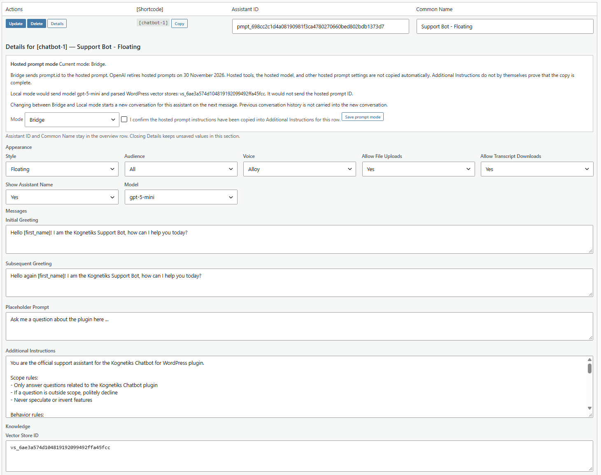

## Managing OpenAI Assistants in Local Mode

Kognetiks Chatbot for WordPress lets you manage OpenAI chatbot settings in WordPress using the **GPT Assistants** tab. With **Local mode**, a chatbot's instructions, model selection, and vector-store configuration are controlled by its saved WordPress assistant row instead of an OpenAI-hosted Prompt Object.

**Important:** OpenAI has announced that hosted Prompt Objects will no longer be available starting **30 November 2026**. If you currently use a `pmpt_` Prompt ID, review and migrate its configuration before that date. **Installing an updated plugin does not automatically switch existing prompts from Bridge to Local or copy their hosted settings.**

### Understanding Bridge and Local Mode

| Mode | How it works | What you need to know |
| --- | --- | --- |
| **Bridge** | Sends the existing `pmpt_` ID to the OpenAI Responses API through `prompt.id`. | Continues to depend on the hosted Prompt Object and its associated configuration. It is a transition option, **not** the long-term replacement for retired hosted prompts. |
| **Local** | Sends the model and instructions configured in WordPress directly to the Responses API, without a hosted `prompt.id`. | You must verify that the WordPress instructions, model, and vector stores provide the behavior previously supplied by the hosted prompt. |

The **Hosted Prompt Mode** panel is shown for applicable `pmpt_` rows. Existing rows remain in **Bridge** unless their mode is explicitly changed and confirmed. Former `asst_` assistant rows use their WordPress configuration through the Responses API and do not show the Bridge/Local selector.

**TIP:** A Prompt ID can remain visible in the Assistant ID column after switching to Local. It identifies the saved assistant configuration in WordPress; Local-mode Responses requests do **not** send that ID as `prompt.id`.

### Migrating a Hosted Prompt to Local Mode

Before changing a visitor-facing chatbot, review the original prompt's instructions, model, tools, and attached knowledge in your OpenAI configuration. Copy or recreate the settings you need in WordPress.

1. In the WordPress administration area, open **Kognetiks Chatbot → Manage Assistants → GPT Assistants**.
2. Locate the `pmpt_` assistant you want to migrate. Click **Details** to expand its editable configuration.
3. Under **Messages**, review **Additional Instructions**. Copy the full instructions needed for the chatbot from the hosted prompt into this field. Do not assume the existing WordPress text already contains every hosted instruction.
4. Under **Appearance**, select a suitable **Model**, or select **Use ChatGPT Model Default** to follow the site's ChatGPT Model Default setting.
5. Under **Knowledge**, enter the OpenAI **Vector Store ID** or IDs needed for file search. Confirm that the stores and their files are available on OpenAI. Hosted tools and prompt settings are **not** copied automatically.
6. Click **Update** on that assistant's overview row to save any changes to its instructions, model, vector stores, greetings, or other editable settings.
7. At the top of Details, find **Hosted Prompt Mode**. Select **Local**, check the confirmation that hosted instructions have been copied, and click **Save prompt mode**. This is a **separate action** from Update.
8. Reload Manage Assistants and confirm the panel reads **Current mode: Local**. Test the chatbot on a page using its numbered shortcode, then review its response and any diagnostic errors.

**CAUTION:** Do not confirm migration unless you've checked the hosted settings against the WordPress configuration. Copying instructions alone does not migrate hosted models, tools, files, or every other prompt setting. If you need to revert temporarily while hosted Prompt Objects remain available, select **Bridge** and use **Save prompt mode** again.

### The Manage Assistants Interface

The GPT Assistants overview has four columns: **Actions**, **[Shortcode]**, **Assistant ID**, and **Common Name**. Each saved row has **Update**, **Delete**, and **Details** buttons. The **Copy** button beside the shortcode copies its shortcode for use in a page or post.

Click **Details** to expand an assistant's settings immediately below its row. Details starts collapsed for saved assistants; you can leave more than one open. Opening or closing Details does not save anything, and closing it does not discard unsaved field edits. The **Add New Assistant** editor starts expanded at the bottom of the table.

### Field Descriptions

#### Overview fields

1. **Actions**:
   - **Update** saves the editable settings for that assistant row.
   - **Delete** removes the assistant row; use it carefully if the shortcode is already published.
   - **Details** shows or hides the assistant's configuration without saving.
   - **Add New Assistant** creates a new row after its required fields are entered.
2. **Shortcode**:
   - **Description:** The generated shortcode, such as `[chatbot-1]`. Numbered `[assistant-1]` and `[agent-1]` forms are also supported.
   - **Usage:** Put the shortcode in the page or post where the chatbot should appear. For best results, use only one chatbot shortcode on a page.
3. **Assistant ID**:
   - **Description:** The associated OpenAI identifier, often beginning with `pmpt_` for a hosted prompt or `asst_` for a former assistant.
   - **Input:** Enter the applicable identifier. Required when adding an assistant.
   - **Local-mode note:** A stored `pmpt_` ID does not mean the hosted prompt is sent in Local mode.
4. **Common Name**:
   - **Description:** A recognizable name for the configuration, such as `Support Bot - Floating`.
   - **Input:** Enter the name. Required when adding an assistant.

#### Hosted Prompt Mode (`pmpt_` rows)

5. **Current mode**:
   - **Description:** Shows whether the saved row currently uses **Bridge** or **Local**.
6. **Mode**:
   - **Input:** Select **Bridge** or **Local**.
   - **Confirmation:** To switch to Local, confirm that you have copied the required hosted prompt instructions into WordPress.
   - **Save:** Click **Save prompt mode** to persist this choice. The assistant's **Update** button is not a substitute for this action.
   - **Preview:** The panel identifies the model and parsed WordPress vector stores that Local mode would send.

#### Appearance

7. **Style**: Choose `Embedded` or `Floating` to control how the chatbot appears.
8. **Audience**: Choose `All`, `Visitors`, or `Logged-in`.
9. **Voice**: Select a supported voice for read-aloud features, or `None` where available.
10. **Allow File Uploads**: Choose `Yes` or `No` to control whether users can upload files.
11. **Allow Transcript Downloads**: Choose `Yes` or `No` to control transcript downloads.
12. **Show Assistant Name**: Choose `Yes` or `No` to control whether the assistant's name is displayed.
13. **Model**:
    - **Input:** Select a model for the assistant or **Use ChatGPT Model Default**.
    - **Precedence:** For applicable Local-mode requests, an explicitly specified shortcode model takes precedence over the saved row model; otherwise the site-wide ChatGPT Model Default is used.
    - **Bridge note:** Bridge relies on the hosted prompt's model rather than sending this row's selected model at the top level.
    - **TIP:** Being listed in the model dropdown does not by itself prove a model supports every Responses API tool or file search. Test your chosen configuration.

#### Messages

14. **Initial Greeting**: The greeting shown when a conversation is first started.
15. **Subsequent Greeting**: The greeting displayed on subsequent visits or conversation openings, as configured.
16. **Placeholder Prompt**: The example text displayed in the empty message-entry field.
17. **Additional Instructions**:
    - **Description:** Multiline instructions saved in the WordPress assistants table. In Local mode, these provide the assistant's instruction text for Responses API requests.
    - **Input:** Include role, scope, response style, sources, and any required response footer or disclaimer.
    - **TIP:** Keep the intended wording in WordPress. A Local-mode request reads the selected row's saved instructions at request time. Save changes with **Update**.

#### Knowledge

18. **Vector Store ID**:
    - **Description:** One or more OpenAI vector-store IDs (`vs_…`) used by the Responses API `file_search` tool.
    - **Input:** Enter valid IDs separated by commas. An empty value configures no WordPress vector stores for that row.
    - **TIP:** A vector-store ID does not upload files or prove the store is accessible. Prepare the store and its documents in OpenAI before testing the chatbot.
    - **Important:** Vector stores supplement **Additional Instructions**; they do not replace instructions, greetings, or other assistant settings.

### Conversation History and Configuration Changes

For OpenAI Responses conversations using these assistant configurations, changing the effective mode, model, instructions, or applicable file-search settings can change the conversation configuration. **The next message starts a new conversation when the effective configuration fingerprint changes.** Previous turns are not copied into the new conversation.

A change to the saved form does not itself start a new conversation until a subsequent message is sent. The chatbot's visible transcript may also be replaced when the browser learns that the server is using a new conversation generation. **Clear** starts a fresh conversation independently of changing assistant settings.

**TIP:** After migrating from Bridge to Local, test both a new question and a follow-up question. Then verify that a later intentional instruction change does not carry the earlier conversation into the new one.

### Troubleshooting

- **The chatbot still appears to use the hosted prompt:** Open Details and verify **Current mode: Local**. Changing the dropdown without clicking **Save prompt mode** does not complete the switch.
- **The chatbot's response does not follow the expected instructions:** Check that **Additional Instructions** were saved with **Update**, that the correct row is selected, and that the active mode is Local. Confirm the expected model is selected.
- **The chatbot does not answer from an attached document:** Verify the vector-store ID, the files inside that store, and the chosen model's compatibility with `file_search`.
- **The chatbot reports that its configuration is unavailable:** Reload the page containing its shortcode to refresh the server-side assistant selection, then try again. If the issue persists, review the assistant row and diagnostics.
- **An earlier conversation seems to disappear after a settings change:** This can be expected when the effective configuration changes and a new conversation generation begins.

For broader field descriptions and general assistant management, see [Managing Assistants and Agents](assistants/manage-assistants.md).

---

- **[Back to the Overview](../overview.md)**
