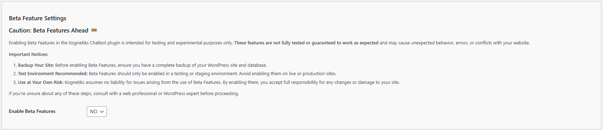

# Configuring Beta Features

The **Kognetiks Chatbot for WordPress** plugin includes the option to enable beta features that may be released in the future.

Enabling Beta Features in the **Kognetiks Chatbot** plugin is intended for **testing and experimental** purposes only. These features are not fully tested or guaranteed to work as expected and may cause unexpected behavior, errors, or conflicts with your website.

**Important Notices**:

**Backup Your Site**: Before enabling Beta Features, ensure you have a complete backup of your WordPress site and database.

Test Environment Recommended: Beta Features should only be enabled in a testing or staging environment. Avoid enabling them on live or production sites.
Use at Your Own Risk: Kognetiks assumes no liability for issues arising from the use of Beta Features. By enabling them, you accept full responsibility for any changes or damage to your site.

If you're unsure about any of these steps, consult with a web professional or WordPress expert before proceeding.

1. **Enable Beta Features**:
   - **Description**: This setting determines if beta features included in the current release have been enabled.
   - **Default Value**: The default value is `NO`.
   - **Options**: `YES` or `NO`.
   - **Selection**: Choose `YES` to enable any beta features for this release mentioned below, otherwise choose to `NO` at any time to disable any beta features.

If you change any settings, be sure to click the `Save Settings` button at the bottom of the settings page.

## Current beta features

**Transformer Model**

1. Enable beta features, then select `Transformer` as the AI platform on the `General` tab. Click `Save Settings` at the bottom of the settings page.

2. An `API/Transformer` tab appears for the platform you selected. Open that tab to choose the transformer settings.

3. **Transformer Model Choice** has three models:

   - `lexical-context-model` answers from individual words and how they appear together in your pages and posts.
   - `sentential-context-model-lite` matches the visitor's question against sentences in your pages and posts by shared words.
   - `sentential-context-model` compares the question with a saved map of which words appear near each other in your content, then returns the closest sentences.

   You can also set **Maximum Tokens** and the advanced settings: build schedule, window size (an n-gram), sentence response count, similarity threshold, and the leading sentence and token ratios.

4. `markov-chain-flask` and `markov-chain-beaker` are planned for a later release. They are not in the Transformer Model Choice list yet.

5. More detail is in [API/Transformer Settings](api-transformer-settings/api-transformer-model-settings.md) and [API/Transformer Model Build Status](api-transformer-settings/api-transformer-model-build-status.md).

---

- **[Back to the Overview](/overview.md)**